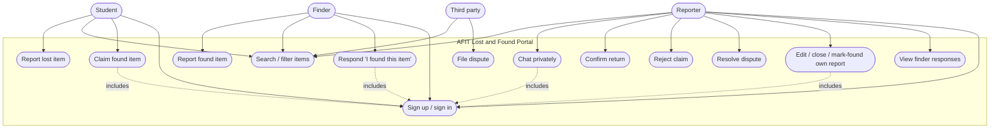
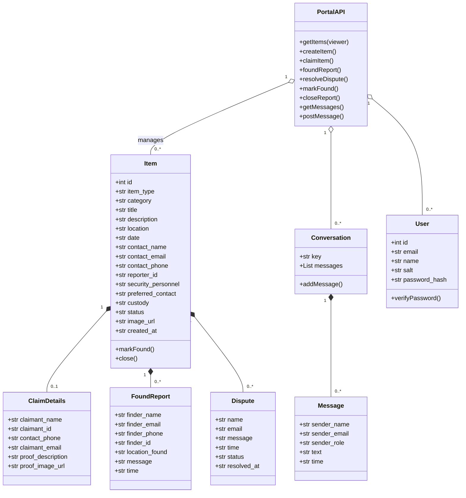
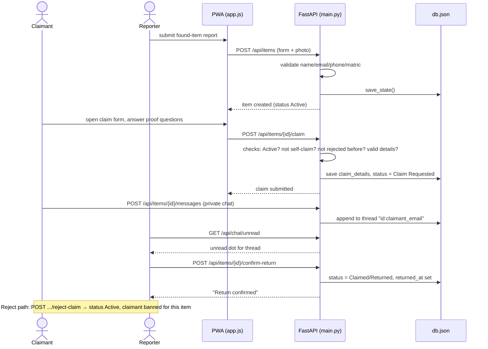
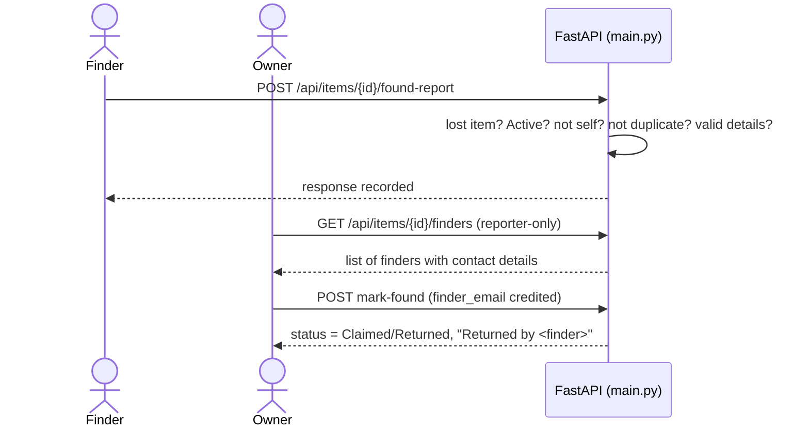
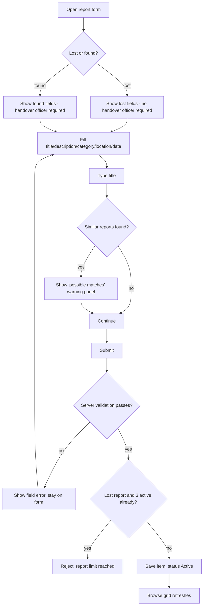
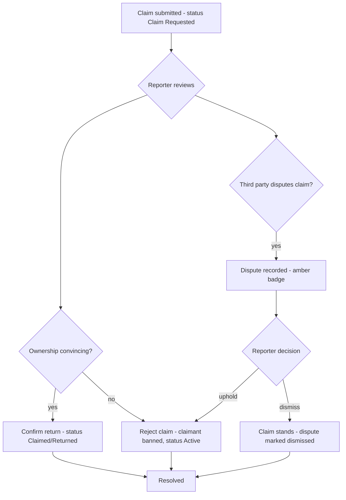

# Week 4 — UML Model Set (SP-014)

**Deliverables:** use case, class, sequence (main flow) and activity diagrams. **Marks: 8**

All diagrams are in Mermaid and render on GitHub/VS Code.

## 1. Use Case Diagram

## 2. Class Diagram (domain + boundary entities)

Status lifecycle of `Item`: `Active → Claim Requested → (Claimed/Returned | Active)`; a lost
item can also be resolved by the reporter: `Active → Claimed/Returned (marked found)` or
`Active → Closed`.

## 3. Sequence Diagram — Main Flow (claim and return of a found item)

## 4. Sequence Diagram — Finder Response Flow (lost items)

## 5. Activity Diagram — Report Submission with Validation and Duplicate Warning

## 6. Activity Diagram — Claim Resolution with Disputes

