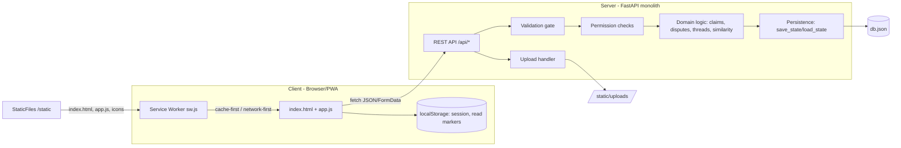
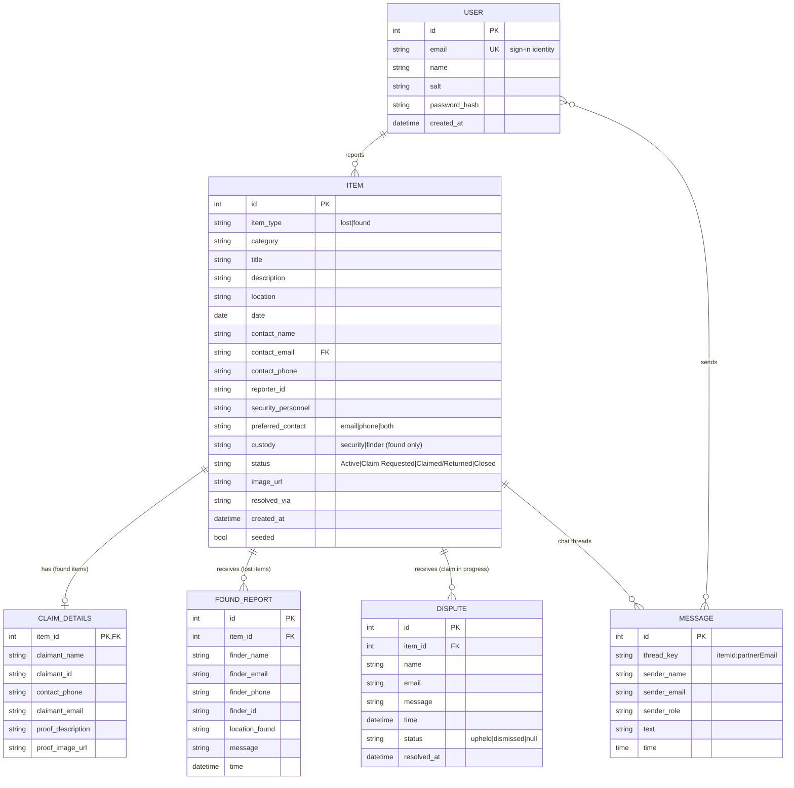

# Week 5 — Software Architecture and Database Design (SP-014)

**Deliverables:** architecture selection/justification, component diagram, ERD, schema script. **Marks: 8**

## 1. Architecture Selection and Justification

**Selected: Layered monolith with a REST API boundary (client–server).**

| Candidate | Assessment |
|-----------|-----------|
| Microservices | 13-week single-developer project; operational overhead (service discovery, distributed deployment) outweighs benefits. Rejected. |
| Event-driven | No high-volume async workloads; polling chat chosen deliberately for demo robustness. Rejected. |
| Serverless | Vendor lock-in and cold starts complicate the class demo. Rejected. |
| **Layered monolith + REST** | Clear separation (presentation / API / domain / persistence), one deployable, trivial to demo offline, and the persistence layer is swappable (file store now, PostgreSQL later). **Selected.** |

The front-end is a **single-page PWA** (vanilla JS, no framework) that talks to the backend
only through the `/api/*` REST boundary — presentation and business logic are never mixed.

## 2. Layers

| Layer | Implementation | Responsibility |
|-------|----------------|----------------|
| Presentation | `static/index.html`, `static/app.js`, Tailwind (CDN), service worker | Rendering, forms, polling, PWA shell |
| API | FastAPI routes in `main.py` (`/api/*`) | Request validation, permission checks, status codes |
| Domain | Item/Claim/Dispute/FoundReport/Conversation logic in `main.py` | Status lifecycle, anti-spam, thread resolution, similarity |
| Persistence | `save_state()` / `load_state()` over `db.json`; `static/uploads/` for images | Durability across restarts |

## 3. Component Diagram



## 4. ERD

The file store is document-oriented, but the logical model is relational and maps 1:1 to the
PostgreSQL schema in §6 (the Week-5 upgrade path).



**Key design decisions**
- `CLAIM_DETAILS` is 1-to-0..1 with `ITEM` (only one active claim at a time); rejected claimants
  are kept in `ITEM.rejected_claimants` (a multi-valued attribute that becomes a table in SQL).
- Chat threads are keyed `itemId:partnerEmail` — the partner (non-reporter) identifies the
  thread, so multiple finders of the same item never share messages.
- `status` is an enum-style string; the lifecycle is enforced in the domain layer.

## 5. Data Dictionary (abbreviated)

| Field | Type | Constraint |
|-------|------|------------|
| item.item_type | enum | `lost`, `found` |
| item.status | enum | `Active`, `Claim Requested`, `Claimed/Returned`, `Closed` |
| item.contact_email | email | format-validated; ownership identity; immutable after creation |
| item.contact_phone | phone | `^(\+234|0)[789]\d{9}$` |
| item.reporter_id | matric | `^(?=.*[A-Za-z])(?=.*\d)[A-Za-z0-9/-]{5,20}$` |
| message.text | text | 1–1000 chars; ≤ 200 per thread |
| user.password_hash | hex | SHA-256(salt ‖ password); salt = 16-byte `secrets.token_hex` |

## 6. Schema Script (PostgreSQL upgrade path)

```sql
CREATE TABLE users (
    id            SERIAL PRIMARY KEY,
    email         VARCHAR(120) UNIQUE NOT NULL,
    name          VARCHAR(80)  NOT NULL,
    salt          CHAR(32)     NOT NULL,
    password_hash CHAR(64)     NOT NULL,
    created_at    TIMESTAMP    DEFAULT now()
);

CREATE TABLE items (
    id                 SERIAL PRIMARY KEY,
    item_type          VARCHAR(6)  NOT NULL CHECK (item_type IN ('lost','found')),
    category           VARCHAR(80) NOT NULL,
    title              VARCHAR(120) NOT NULL,
    description        VARCHAR(1000) NOT NULL,
    location           VARCHAR(80) NOT NULL,
    report_date        DATE        NOT NULL,
    contact_name       VARCHAR(80) NOT NULL,
    contact_email      VARCHAR(120) NOT NULL,
    contact_phone      VARCHAR(16) NOT NULL,
    reporter_id        VARCHAR(20) NOT NULL,
    security_personnel VARCHAR(80),
    preferred_contact  VARCHAR(5)  DEFAULT 'both' CHECK (preferred_contact IN ('email','phone','both')),
    custody            VARCHAR(8)  CHECK (custody IN ('security','finder')),
    status             VARCHAR(20) NOT NULL DEFAULT 'Active'
                       CHECK (status IN ('Active','Claim Requested','Claimed/Returned','Closed')),
    image_url          VARCHAR(300),
    resolved_via       VARCHAR(120),
    seeded             BOOLEAN     DEFAULT FALSE,
    created_at         TIMESTAMP   DEFAULT now()
);
CREATE INDEX idx_items_status ON items(status);
CREATE INDEX idx_items_type   ON items(item_type);
CREATE INDEX idx_items_owner  ON items(contact_email);

CREATE TABLE claim_details (
    item_id           INTEGER PRIMARY KEY REFERENCES items(id) ON DELETE CASCADE,
    claimant_name     VARCHAR(80) NOT NULL,
    claimant_id       VARCHAR(20) NOT NULL,
    contact_phone     VARCHAR(16) NOT NULL,
    claimant_email    VARCHAR(120) NOT NULL,
    proof_description VARCHAR(1000),
    proof_image_url   VARCHAR(300)
);

CREATE TABLE rejected_claimants (
    item_id       INTEGER REFERENCES items(id) ON DELETE CASCADE,
    claimant_email VARCHAR(120),
    PRIMARY KEY (item_id, claimant_email)
);

CREATE TABLE found_reports (
    id             SERIAL PRIMARY KEY,
    item_id        INTEGER NOT NULL REFERENCES items(id) ON DELETE CASCADE,
    finder_name    VARCHAR(80) NOT NULL,
    finder_email   VARCHAR(120) NOT NULL,
    finder_phone   VARCHAR(16) NOT NULL,
    finder_id      VARCHAR(20) NOT NULL,
    location_found VARCHAR(120),
    message        VARCHAR(500),
    time           TIMESTAMP DEFAULT now(),
    UNIQUE (item_id, finder_email)
);

CREATE TABLE disputes (
    id          SERIAL PRIMARY KEY,
    item_id     INTEGER NOT NULL REFERENCES items(id) ON DELETE CASCADE,
    name        VARCHAR(80) NOT NULL,
    email       VARCHAR(120) NOT NULL,
    message     VARCHAR(1000) NOT NULL,
    time        TIMESTAMP DEFAULT now(),
    status      VARCHAR(10) CHECK (status IN ('upheld','dismissed')),
    resolved_at TIMESTAMP
);

CREATE TABLE messages (
    id           SERIAL PRIMARY KEY,
    thread_key   VARCHAR(140) NOT NULL,   -- 'itemId:partnerEmail'
    sender_name  VARCHAR(80) NOT NULL,
    sender_email VARCHAR(120) NOT NULL,
    sender_role  VARCHAR(10) NOT NULL,
    text         VARCHAR(1000) NOT NULL,
    time         TIMESTAMP DEFAULT now()
);
CREATE INDEX idx_messages_thread ON messages(thread_key);
```
